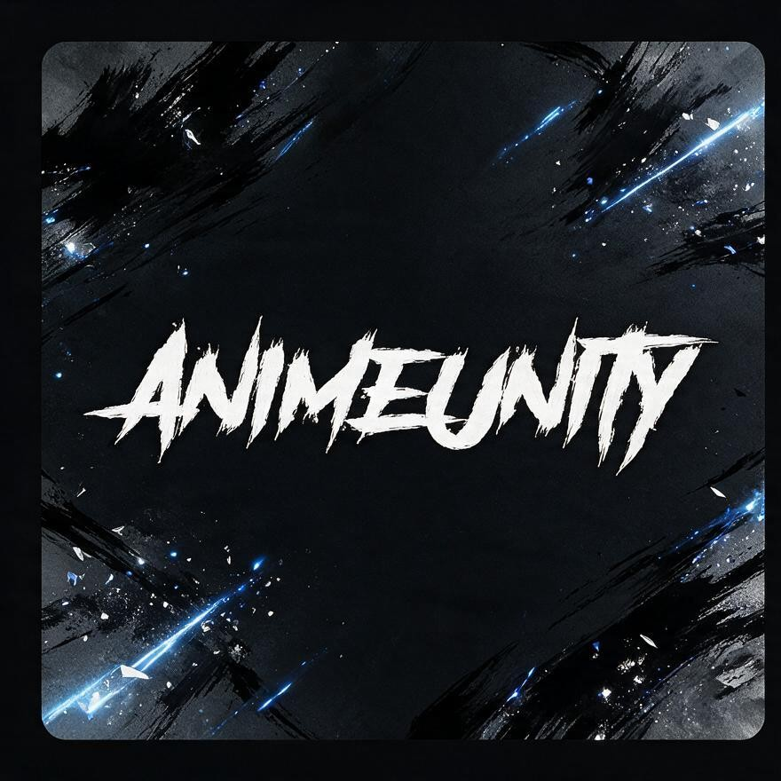

<p align="center">
  
</p>

<h2 align="center">Addon Stremio per anime</h2>

<p align="center">
  Cerca e aggrega stream da AnimeUnity, AnimeSaturn e AnimeWorld in un'unica interfaccia.
</p>

| AnimeUnity | AnimeSaturn | AnimeWorld |
|:---:|:---:|:---:|
|  |  |  |

> **Progetto vibecoded.** HanX è un derivato di
> [StreamViX](https://github.com/qwertyuiop8899/StreamViX) ed è scritto con
> agenti AI: nessuna garanzia di stabilità, sicurezza o supporto. Dettagli in
> [Crediti](#crediti).


## Indice

- [Cosa fa](#cosa-fa)
- [Installazione](#installazione)
- [Configurazione](#configurazione)
- [Riproduzione: diretta o con proxy](#riproduzione-diretta-o-con-proxy)
- [Mapping anime](#mapping-anime)
- [API](#api)
- [Sviluppo](#sviluppo)
- [Struttura](#struttura)
- [Appendici](#appendici)
  - [Copertura e limiti del mapping](#copertura-e-limiti-del-mapping)
  - [Limiti noti](#limiti-noti)
  - [Crediti](#crediti)

## Cosa fa

- Cerca in parallelo sui tre provider, con fallback automatico quando uno non
  risponde.
- Accetta ID **MyAnimeList** (MAL), **Kitsu**, **IMDb**, **TMDB** e **TVDB**.
- Riproduce in **diretta** o tramite **EasyProxy** (HLS), con gli header
  corretti per ogni sito.
- Offre una configurazione web integrata: apri `/`, scegli le sorgenti e ottieni
  il link da incollare in Stremio.
- Rispetta i limiti dei siti: pacing per host, cache delle ricerche, stop dopo
  un `403` o un `429`.

## Installazione

HanX si installa come **stack Docker Compose**: un servizio, un volume per i
dati, nessuna dipendenza da installare. Lo stesso YAML funziona da CLI con
`docker compose` e nei gestori di stack (Portainer, Dockhand) incollato in
**Stacks → Add stack**.

Requisiti: Docker con Compose v2 (`docker compose version`).

### La stack

```yaml
services:
  hanx:
    image: lextutor/hanx:latest
    container_name: HanX
    ports:
      - "7000:7000"
    volumes:
      - hanx-data:/app/data
    environment:
      - PORT=7000
      - ANIME_MAPPING_URL=https://raw.githubusercontent.com/Dexxtex/HanX/mapping/anime-seasons.json
      - ANIME_MAPPING_FILE=/app/data/anime-seasons.json
      - TMDB_API_KEY=${TMDB_API_KEY:-}
      - TVDB_API_KEY=${TVDB_API_KEY:-}
      - TVDB_PIN=${TVDB_PIN:-}
      - EASYPROXY_URL=${EASYPROXY_URL:-}
      - EASYPROXY_PASSWORD=${EASYPROXY_PASSWORD:-}
      - PROXY=${PROXY:-}
      - AU_PROXY=${AU_PROXY:-}
      - AS_PROXY=${AS_PROXY:-}
      - AW_PROXY=${AW_PROXY:-}
    restart: unless-stopped

volumes:
  hanx-data:
```

Salva il file come `compose.yaml`, oppure incollalo nello stack manager. I
valori `${...}` si impostano in un `.env` accanto al file oppure nel pannello
**Environment** dello stack; tutte le variabili sono in
[`.env.example`](.env.example).

```bash
docker compose up -d
```

Apri <http://localhost:7000>, scegli le sorgenti e installa l'addon in Stremio.

### Aggiornamento

```bash
docker compose pull
docker compose up -d
```

Dalla UI dello stack è **Update the stack** / **Recreate**. Il volume
`hanx-data` conserva indice, cache e configurazione: non si perde.

### Immagine e build

| Registry | Immagine |
| --- | --- |
| Docker Hub | `lextutor/hanx:latest` |
| GitHub Packages | `ghcr.io/dexxtex/hanx:latest` |

Ogni tag `vX.Y.Z` pubblica i tag `X.Y.Z`, `X.Y`, `X`, `latest` e una **Release**
con le note generate dai commit. Non serve autenticarsi ai registry.

Per compilare l'immagine dal sorgente (solo se modifichi il codice):

```bash
docker build -t lextutor/hanx:latest .
docker compose up -d
```

## Configurazione

Tutte le variabili sono in [`.env.example`](.env.example). Le principali:

| Variabile | Significato | Default |
| --- | --- | --- |
| `PORT` | Porta del server | `7000` |
| `TMDB_API_KEY` | TMDB, per metadati e mapping | — |
| `TVDB_API_KEY` / `TVDB_PIN` | TVDB v4, per ordine episodi e fallback | — |
| `ANIME_MAPPING_URL` | Indice mapping scaricato all'avvio | branch `mapping` su GitHub |
| `EASYPROXY_URL` / `EASYPROXY_PASSWORD` | Proxy HLS per la riproduzione | — |
| `PROXY`, `AU_PROXY`, `AS_PROXY`, `AW_PROXY` | Forward proxy per lo scraping (HTTP/SOCKS) | — |
| `ANIMEUNITY_ENABLED`, `ANIMESATURN_ENABLED`, `ANIMEWORLD_ENABLED` | Sorgenti attive | `true` |
| `ANIME_HOST_MIN_INTERVAL_MS` | Distanza minima tra richieste allo stesso host | `2000` |
| `DEBUG_LEVEL` | `0`–`4`, da spento a trace | `0` |

Le chiavi restano nel `.env` locale: non committare il file. Se esponi la
landing su Internet, proteggila con autenticazione davanti.

### Dietro un reverse proxy

La landing costruisce il link del manifest da `X-Forwarded-Host`/`-Proto`,
quindi non serve configurare host o porta. Con Caddy basta:

```caddyfile
hanx.example.com {
    reverse_proxy 127.0.0.1:7000
}
```

Il link `stremio://` richiede HTTPS (o `127.0.0.1`). Se il pulsante **Installa
in Stremio** non parte, usa **Installa da Stremio Web** oppure incolla il
manifest a mano in Stremio → Addons.

## Riproduzione: diretta o con proxy

La landing offre due modalità, valide per tutti e tre i provider:

- **Diretta** — URL del sito, con gli header corretti. Funziona quando il player
  e il server escono dallo stesso IP pubblico.
- **Con proxy** — tutto passa da EasyProxy, che risolve manifest e segmenti dal
  suo IP.

EasyProxy è un servizio separato
([realbestia1/EasyProxy](https://github.com/realbestia1/EasyProxy)): avvialo,
poi inserisci URL e password nella landing o nel `.env`.

EasyProxy ha bisogno di `brotli` per decodificare le risposte HTTP compresse. Se
l'immagine non lo include, sovrascrivi l'entrypoint nel suo servizio Compose:
installa il pacchetto e poi lancia l'entrypoint originale.

```yaml
services:
  easyproxy:
    # ... resto della configurazione ...
    entrypoint:
      - /bin/bash
      - -c
      - |
        python -m pip install --no-cache-dir --quiet brotli \
          || echo "brotli non installato: proseguo senza" >&2
        exec /bin/bash /app/entrypoint.sh
```

I proxy `PROXY`/`AU_PROXY`/`AS_PROXY`/`AW_PROXY` sono un'altra cosa: servono
allo **scraping**, non alla riproduzione, e si attivano appena impostati.

> **Perché il pacing.** Cloudflare risponde con una challenge quando l'uscita fa
> raffica. Un titolo può costare fino a 15 richieste: senza limite l'IP si
> brucia in una sera, e un `403` non si recupera insistendo.

## Mapping anime

Stremio manda ID e stagione; i siti italiani vogliono un titolo. Il livello
`src/mapping/` fa da ponte e usa solo API ufficiali:

| Fonte | A cosa serve |
| --- | --- |
| **Kitsu** | collegamento MAL → Kitsu e relazioni `sequel`/`prequel` |
| **TMDB** | entry TMDB da titolo + anno, e da lì IMDb/TVDB; titolo italiano |
| **TVDB v4** | ordine episodi (`aired order`) |
| **Tenrai** | metadati MAL a runtime, con cache SQLite ed ETag |

L'indice (`anime-seasons.json`) viene costruito dalla workflow
[`anime-mapping.yml`](.github/workflows/anime-mapping.yml): ogni notte converte
le nuove entry del catalogo MAL e pubblica indice **e cursore** sul branch
orfano `mapping` (un commit solo, senza storia: il repository non cresce).
L'addon lo scarica da `ANIME_MAPPING_URL` e lo ricontrolla ogni 24 ore; se il
download fallisce, continua con la copia locale.

**L'indice incluso nell'immagine è vuoto**: senza `ANIME_MAPPING_URL` servono
`TMDB_API_KEY` e `TVDB_API_KEY` per il fallback live, che copre meno casi.

## API

| Endpoint | Descrizione |
| --- | --- |
| `/stream/anime/{id}.json` | Stream per anime |
| `/stream/film/{id}.json` | Stream per film |
| `/stream/serie/{id}.json` | Stream per serie |

ID supportati: `mal:123`, `kitsu:123`, `tt1234567`, `tmdb:12345`, `tvdb:12345`.

## Sviluppo

Richiede Node.js 24+ (`node:sqlite` per la cache Tenrai).

```bash
pnpm install
pnpm run dev             # hot reload
pnpm run build           # tsc + copia config e indice in dist/
pnpm start               # esegue dist/ (dopo build)
pnpm test                # build + test (node:test)
pnpm run check:domains   # verifica i domini dei provider
pnpm run mapping:verify  # controlla l'indice del mapping
```

Senza Docker: `pnpm install && pnpm run build && pnpm start`.

## Struttura

```text
src/
  addon.ts            entry point e manifest
  landingPage.ts      interfaccia web di configurazione
  config.ts           parsing di env e link
  mapping/            risoluzione ID → titolo/stagione
  providers/          AnimeUnity, AnimeSaturn, AnimeWorld
  utils/              HTTP, cache, logger, normalizzazione titoli
  types/
scripts/              converter del mapping e utility
config/               domini e URL dei provider
public/               icona e sfondo
tests/                test (node:test)
```

## Appendici

### Copertura e limiti del mapping

Catalogo MAL: 13.799 entry tra serie TV e film, **8.435 mappate (61,1%)** —
passata completa e retry finale al 24/10/2026.

| Esito | Significato |
| --- | --- |
| `ok` | allineata su TVDB (o TMDB se TVDB manca) |
| `already` | split cour già coperto |
| `no-kitsu` | Kitsu non ha il mapping MAL né un titolo corrispondente |
| `no-tmdb` | titolo assente da TMDB e TVDB |
| `no-align` | TVDB esiste ma senza episodi datati compatibili |

I tre residui (`no-kitsu`, `no-tmdb`, `no-align`) sono buchi di catalogo, non
errori di match. Ponti alternativi (AniList, AniDB, TsukiHime) sono stati
misurati e scartati: non aggiungono ID.

Ogni range dell'indice porta `titleAlt` (romaji MAL) e l'entry porta `titleIt`
(titolo italiano TMDB): i siti listano spesso l'uno o l'altro, e con il solo
titolo inglese la ricerca dà 0 risultati. Entrambi entrano solo dopo che
l'inglese ha fallito.

Caso non coperto: una scheda del sito che contiene l'intera serie (episodi 1..N)
etichettata come stagione può far prendere l'episodio di un'altra stagione.
Servirebbe l'episodio assoluto, che oggi i provider non ricevono.

### Limiti noti

- Il mapping non copre tutto il catalogo: i buchi sono documentati sopra.
- I tre siti sono protetti da Cloudflare: senza pacing e cache l'IP (o il proxy)
  viene bloccato.
- EasyProxy è opzionale ma consigliato per la riproduzione fuori casa.

### Crediti

HanX riprende [StreamViX](https://github.com/qwertyuiop8899/StreamViX), addon
Stremio/NUVIO per anime da AnimeUnity, AnimeSaturn e AnimeWorld. La base di
partenza è StreamViX 12.4.23; da lì HanX ha modificato mapping, provider e
landing. HanX non è affiliato a StreamViX né ai siti di streaming.

Il progetto è **vibecoded**: il codice è stato prodotto con agenti AI, senza
revisione umana sistematica. Va usato a proprio rischio.

---

**HanX** — anime streaming, semplificato.
