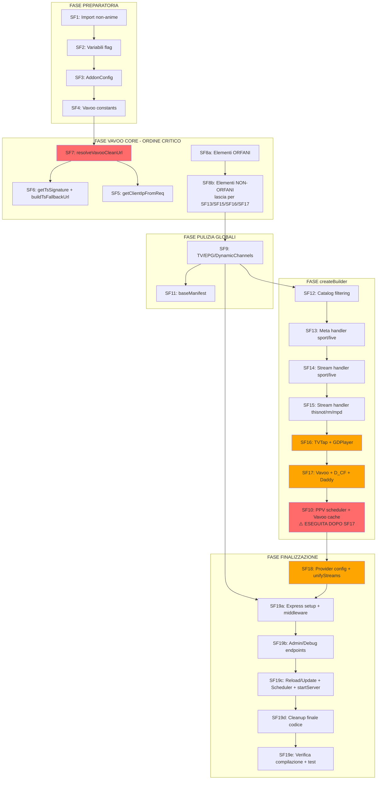

# 📋 PIANIFICAZIONE COMPLETA FASE 8 — PULIZIA ADDON.TS

> **File target**: `src/addon.ts` (~10574 righe editor, ~600KB)
> **Obiettivo**: Rimuovere tutto il codice non-anime da addon.ts
> **Stato**: SF1, SF2, SF3 COMPLETATE ✅ — PROSEGUIMENTO CON SF4→SF19e (ordine lineare)
> **Data ultima verifica**: 09/10/2026
>
> **Nota fondamentale**: Il dato corretto delle righe è SEMPRE quello dell'**editor**.
> Il terminale conta diversamente (es. addon.ts = ~10574 editor, 9775 terminale).
> **Usare SEMPRE i numeri di riga dell'editor per tutti i file del progetto.**

---

## ✅ STATO CRITICO RISOLTO (SF1 — 09/10/2026)

I **16 import verso file inesistenti** sono stati rimossi in SF1.

> ℹ️ Restano 2 import dinamici (`toon-provider`, `toonitalia-provider`) che non bloccano la compilazione TypeScript ma possono causare errori a runtime — saranno rimossi in SF1/SF12-SF18.

| Categoria | File eliminati | Import ancora in addon.ts |
|-----------|---------------|---------------------------|
| Updater sport/live TV (10) | sportzxUpdater, sports99Updater, mediahostingUpdater, freeshotUpdater, paccUpdater, sportstreamUpdater, mpdzUpdater, mpdpUpdater, rmUpdater, thisnotChannels | ✅ Presenti |
| Utility (3) | dynamicChannels, epg, gdplayerRuntime | ✅ Presenti |
| Provider non-anime (3) | guardoserie, guardaflix, trailerProvider | ✅ Presenti |

**Totale**: 16 import verso file inesistenti → addon.ts **NON COMPILA**

> **Nota**: Nel file ci sono anche 3 import non-anime che **NON bloccano** la compilazione:
> - `easyproxyDvr.ts` (riga 55) → **FILE ESISTE ma NON usato da anime** (solo modulo DVR) — rimuovibile in SF1
> - ⚠️ **DISTINZIONE**: `easyproxyDvr.ts` (FILE, rimuovibile) ≠ **EasyProxy** (SERVIZIO PROXY, DA MANTENERE per anime)
> - `amstaffUpdater` (riga 35) → **COMMENTATO OUT** (`// import ...`)
> - `zEventiUpdater` (riga 50) → **COMMENTATO OUT** (`// import ...`)

---

## RIEPILOGO CODICE NON-ANIME PRESENTE (VERIFICATO)

### Import attivi non-anime (16 import verso file inesistenti)
- ✅ **RIMossi in SF1** (09/10/2026)
- guardoserie, guardaflix, trailerProvider
- dynamicChannels, EPGManager, gdplayerRuntime

> ℹ️ `easyproxyDvr.ts` — FILE ESISTE ma **NON usato da anime** (solo modulo DVR). Import in addon.ts (L53) + 5 call site (L2027, L2582, L3389, L5977, L6215) → tutti sezioni DVR/sport/live. **Rimuovibile in SF1 (import) + SF12 (DVR catalog/meta/stream)**.
>
> ⚠️ **DISTINZIONE CRITICA**: `easyproxyDvr.ts` (FILE DVR, rimuovibile) ≠ **EasyProxy** (SERVIZIO PROXY alternativo a MediaFlow, DA MANTENERE per anime). `mediaFlowProxyUrl` può puntare a EasyProxy o MediaFlow Proxy (`useMediaFlow` toggle).

### Config fields non-anime (19 campi attivi in baseManifest.config)
- dvrEnabled, disableVixsrc, vixDirect, vixDirectFhd, vixProxy
- disableLiveTv, trailerEnabled, vidxgoEnabled, guardoserieEnabled, guardaflixEnabled
- guardahdEnabled, adnEnabled, cinemacityEnabled, eurostreamingEnabled, toonitaliaEnabled
- toonEnabled, cb01Enabled, vavooNoMfpEnabled, fastMode
- ℹ️ personalTmdbKey + mediaflowMaster → UI helper (non toccati)
- ℹ️ tvtapProxyEnabled (riga 921) → già commentato out + TVTAP RIMOSSO

### Catalog non-anime (7 catalog)
- streamvix_tv, streamvix_live, streamvix_eventi, streamvix_dvr
- streamvix_tv_search, streamvix_live_search, streamvix_eventi_search

### Funzioni non-anime (~10 funzioni, ~800 righe)
- buildTsFallbackUrl (Vavoo)
- resolveVavooCleanUrl (Vavoo, ~217 righe)
- getTsSignature (Vavoo)
- getStreamPriority (sport/live)
- sortStreamsByPriority (sport/live)
- getStreamName (live TV)
- extractDlhdIdFromCf, isCfDlhdProxy (CF DLHD)
- getClientIpFromReq (Vavoo, ~90 righe)

### Variabili globali non-anime (~30 variabili)
- EPG, Vavoo constants, scheduler flags, dynamicChannels

### Blocchi meta/stream non-anime in createBuilder (~4000+ righe)
- 10+ meta handler per updater sport
- 10+ stream handler per updater sport
- Vavoo stream extraction (~1000 righe)
- Guardoserie/Guardaflix/Trailer stream
- GuardaSerie, VidXgo, CinemaCity, GuardaHD, ADN, Eurostreaming, ToonItalia, TOON, CB01

### Admin/debug endpoints (~500+ righe)
- Chapta/captcha resolution (uprot, clicka)
- Live events scheduler (Live.py)
- Test URL resolution
- Debug endpoints

---

## LE 19 SOTTO-FASI (RIEPILOGO)

| # | Sotto-fase | Righe stimate | Difficoltà |
|---|------------|---------------|------------|
| 1 | Rimozione import non-anime (16 import) | ~55 | Bassa |
| 2 | Rimozione variabili flag | ~6 | Bassa |
| 3 | Pulizia interfaccia AddonConfig | ~29 | Bassa |
| 4 | Rimozione Vavoo constants | ~35 | Bassa |
| 5 | Rimozione getClientIpFromReq | ~90 | Media |
| 6 | Rimozione getTsSignature + buildTsFallbackUrl | ~19 | Bassa |
| 7 | Rimozione resolveVavooCleanUrl | ~217 | Alta |
| 8 | Rimozione Vavoo cache vars (solo orfani SF8a) | ~47 | Alta |
| 9 | Rimozione TV/EPG/DynamicChannels vars, watchers, init, admin refs | ~1550 | **MOLTO ALTA** |
| 10 | Rimozione PPV scheduler + Vavoo cache + funzioni correlate (DOPO SF17) | ~262 | **MOLTO ALTA** |
| 11 | Pulizia baseManifest | ~175 | Media |
| 12 | Rimozione catalog filtering in createBuilder | ~240 | Media |
| 13 | Rimozione meta handler sport/live | ~190 | Alta |
| 14 | Rimozione stream handler sport/live | ~387 | Alta |
| 15 | Rimozione stream handler thisnot/rm/mpd (3 blocchi) | ~1236 | **MOLTO ALTA** |
| 16 | Rimozione TVTap + GDPlayer (2 blocchi: GDPlayer 4564-4657 + TVTap 5613-6155) | ~1498 | **MOLTO ALTA** |
| 17 | Rimozione stream handler vavoo + D_CF + Daddy (3 blocchi: VavooClean 3652-3904 + D_CF/Vavoo 5062-5611 + VavooClean prepend 6159-6209) | ~2305 | **MOLTO ALTA** |
| 18 | Pulizia config provider non-anime + snellimento funzioni shared | ~830 | **MOLTO ALTA** |
| 19 | Rimozione admin endpoints + scheduler + cleanup | ~3260 | **MOLTO ALTA** |

---

## OBIETTIVO FINALE

- **Prima**: ~10574 righe (~600KB), **NON COMPILA** (16 import inesistenti)
- **Dopo SF1**: ~10530 righe, **COMPILA** ✅ (import inesistenti rimossi)
- **Dopo FASE 8 completa**: ~3500-4000 righe (~200-250KB), **COMPILA** ✅
- **Riduzione**: ~6575-7075 righe (-62-67%)

---

## 📌 FILE GIA' ELIMINATI (ma import ancora in addon.ts)

| # | File | Scopo |
|---|------|-------|
| 1 | `src/utils/dynamicChannels.ts` | Canali TV dinamici |
| 2 | `src/utils/epg.ts` | EPG Manager |
| 3 | `src/extractors/gdplayerRuntime.ts` | GDPlayer resolver |
| 4 | `src/utils/rmUpdater.ts` | RM updater |
| 5 | `src/utils/thisnotChannels.ts` | ThisNot updater |
| 6 | `src/utils/sportzxUpdater.ts` | SportzX updater |
| 7 | `src/utils/sports99Updater.ts` | Sports99 updater |
| 8 | `src/utils/mediahostingUpdater.ts` | MediaHosting updater |
| 9 | `src/utils/freeshotUpdater.ts` | Freeshot updater |
| 10 | `src/utils/paccUpdater.ts` | pa.cc updater |
| 11 | `src/utils/sportstreamUpdater.ts` | SportStream updater |
| 12 | `src/utils/mpdzUpdater.ts` | MPDZ updater |
| 13 | `src/utils/mpdpUpdater.ts` | MPDP updater |
| 14 | `src/providers/guardoserie.ts` | Guardoserie |
| 15 | `src/providers/guardaflix.ts` | Guardaflix |
| 16 | `src/providers/trailerProvider.ts` | Trailer TMDB |

> **Nota**: `easyproxyDvr.ts` — **VERIFICATO: NON usato da anime**. Usato SOLO da sezioni non-anime in addon.ts (DVR catalog L2025, DVR meta L2582, DVR stream L3389, Dynamic Events DVR L5977, Vavoo DVR L6215). **Può essere rimosso** con SF1 (import) e SF12 (catalog/meta/stream DVR).

---

## 🔥 ORDINE DI ESECUZIONE — FASE 8 (CRITICO)

> **Seguire rigorosamente questo ordine sequenziale.** Ogni sottofase dipende dalla precedente.
> Eseguire fuori ordine causerebbe errori di compilazione e rotture del codice anime.

### FASE PREPARATORIA (SF1 → SF4)

```
SF1: Rimuovi import non-anime (righe 13-55)
  │  Risolve il problema di compilazione — 16 import verso file inesistenti
  │
  ▼
SF2: Rimuovi variabili flag non-anime (righe 60-65)
  │  DISABLE_LIVE_EVENTS, IS_MH_DISABLED, IS_SS_DISABLED, IS_TN_ENABLED, IS_SP99_ENABLED
  │
  ▼
SF3: Pulisci interfaccia AddonConfig (righe 66-94)
  │  Rimuovi campi non-anime, mantieni: tmdbApiKey, mediaFlowProxyUrl, useMediaFlow,
  │  enableMpd, animeunityEnabled, animesaturnEnabled, animeworldEnabled
  │
  ▼
SF4: Rimuovi Vavoo constants (righe 105-139)
  │  vdbg, VAVOO_FORCE_SERVER_IP, VAVOO_LOG_SIG_FULL, maskSig,
  │  VAVOO_WORKER_URLS, VAVOO_API_UA, VAVOO_RESOLVE_UA, VAVOO_TS_UA,
  │  VAVOO_CLEAN, VAVOO_PROXY, VAVOO_DIRECT
  │
  │  ⚠️ SF4 è la BASE: SF7 dipende da questi simboli
  │
```

---

### FASE VAVOO CORE (SF7 → SF6 → SF5 → SF8) — ⚡ ORDINE CRITICO

```
SF7: Rimuovi resolveVavooCleanUrl + TUTTI i call site esterni (righe 254-471 + 3845, 5544, 5594)
    │
    │  DIPENDE DA: SF4 (vdbg, VAVOO_*)
    │  ⚠️ DEVE ESSERE PRIMA DI SF5, SF6, SF8 — è il "collo di bottiglia"
    │
    │  Cosa rimuove:
    │  - Funzione resolveVavooCleanUrl (righe 254-471)
    │  - Call site alias clean (riga 3845)
    │  - Call site variant clean (riga 5544)
    │  - Call site fallback variant clean (riga 5594)
    │  - Variabili di supporto: vavooCleanPromises, vavooCleanPrepend,
    │    vavooFoundUrls, lastIpByStreamId (usate a 6159-6209, diventano orfane)
    │
    │  Dipendenze interne della funzione:
    │  - SF4: vdbg, VAVOO_API_UA, VAVOO_LOG_SIG_FULL, maskSig, VAVOO_RESOLVE_UA,
    │         VAVOO_WORKER_URLS, VAVOO_TS_UA
    │  - SF5: getClientIpFromReq (righe 3841, 5532, 5582) → diventano orfani
    │  - SF6: getTsSignature (riga 454), buildTsFallbackUrl (riga 456) → diventano orfane
    │  - SF8: DEFAULT_VAVOO_UA (righe 411, 445) → ancora usato in createBuilder
    │
    ▼

SF6: Rimuovi getTsSignature + buildTsFallbackUrl (righe 233-251)
    │
    │  DIPENDE DA: SF7 (che rimuove i call site 454, 456)
    │  ⚠️ Se eseguita PRIMA di SF7 → resolveVavooCleanUrl chiama funzioni inesistenti
    │
    │  Cosa rimuove:
    │  - getTsSignature (righe 233-244) — orfana, nessun call site esterno
    │  - buildTsFallbackUrl (righe 246-251) — orfana, nessun call site esterno
    │
    ▼

SF5: Rimuovi getClientIpFromReq (righe 141-231)
    │
    │  DIPENDE DA: SF7 (che rimuove i call site 3841, 5532, 5582)
    │  ⚠️ Se eseguita PRIMA di SF7 → i call site restano orfani ma la funzione viene rimossa
    │
    │  Cosa rimuove:
    │  - getClientIpFromReq (righe 141-231)
    │  - Call site logging (righe 7326, 8485) — ultimi call site residui
    │
    │  ⚠️ Tutti gli altri call site (3841, 5532, 5582) sono stati rimossi con SF7
    │
    ▼

SF8: Rimuovi Vavoo cache vars (solo orfani SF8a) (righe 474-756)
    │
    │  ⚠️ SF8 contiene 16 elementi: SOLO 6 sono ORFANI, 10 sono NON-ORFANI
    │  ⚠️ SF8 NON dipende da SF7 — tutti gli elementi SF8a sono indipendenti (dead code mai usato)
    │
    │  SF8a — Elementi ORFANI (dead code mai usato — rimuovi subito):
    │  - vavooCleanCache (riga 477) → mai usato in addon.ts (nessun call site)
    │  - VAVOO_CLEAN_TTL_MS (riga 478) → mai usato in addon.ts (nessun call site)
    │  - resolveDynamicEventUrl (righe 492-533) → mai chiamata in addon.ts (nessun call site)
    │  - dynamicStreamCache (riga 489) → usato SOLO dentro resolveDynamicEventUrl (mai chiamata)
    │  - DYNAMIC_STREAM_TTL_MS (riga 490) → usato SOLO dentro resolveDynamicEventUrl (mai chiamata)
    │  - isCfDlhdProxy (riga 756) → mai chiamata in addon.ts (nessun call site)
    │
    │  SF8b — Elementi NON-ORFANI (LASCIARE — verranno rimossi da SF13/SF16/SF17):
    │  - configCache (riga 474) → usato in SF13 (catalog filtering)
    │  - DEFAULT_VAVOO_UA (riga 482) → usato in SF16 (L5951,5959), SF17 (L6173,6187,6194)
    │  - getChannelCategories (righe 536-545) → usato in SF13 (4 call site)
    │  - decodeStaticUrl (righe 553-568) → ⚠️ orfana dopo SF15 (12 call site rimosse da SF15)
    │  - decodeBase64 (riga 548) → usato da decodeStaticUrl (lasciare)
    │  - getStreamPriority (righe 590-650) → ⚠️ orfana dopo SF16 (transitivamente da sortStreamsByPriority)
    │  - sortStreamsByPriority (righe 656-696) → SF16: L4621 (GDPlayer) + L5970 (TVTap), ORFANA dopo SF16
    │  - getStreamName (righe 703-708) → SF16: L5953,5961,5963; SF17: L6189,6196,6198
    │  - extractDlhdIdFromCf (righe 711-743) → usato in SF17 (6 call site)
    │  - buildCfProxyFromId (righe 745-754) → usato in SF17 (4 call site)
    │
    │  ⚠️ NON rimuovere configCache: è usato per campi anime (tmdbApiKey, useMediaFlow, ecc.)
    │
```

---

### FASE PULIZIA GLOBALI (SF9 → SF11)

```
SF9: Rimozione completa infrastruttura TV/EPG/DynamicChannels
    │
    │  DIPENDE DA: SF1 (importi), SF2 (DISABLE_LIVE_EVENTS), SF8b (configCache)
    │  CONSULENTA: SF10 (Vavoo cache vars), SF19 (admin endpoints)
    │  IMPATTO: ~1550 righe totali distribuite in 7 blocchi disgiunti
    │
    │  ┌─────────────────────────────────────────────────────────────────┐
    │  │ BLOCCO 1 — Import dynamicChannels (riga ~13)                    │
    │  │ Rimuovi: import { mergeDynamic, loadDynamicChannels, ... }     │
    │  │    from './utils/dynamicChannels'                              │
    │  │ Note: file dynamicChannels.ts NON ESISTE                       │
    │  └─────────────────────────────────────────────────────────────────┘
    │
    │  ┌─────────────────────────────────────────────────────────────────┐
    │  │ BLOCCO 2 — Import EPGManager (riga ~27)                         │
    │  │ Rimuovi: import { EPGManager } from './utils/epg'              │
    │  │ Note: file epg.ts NON ESISTE                                   │
    │  └─────────────────────────────────────────────────────────────────┘
    │
    │  ┌─────────────────────────────────────────────────────────────────┐
    │  │ BLOCCO 3 — Variabili globali TV/EPG (righe 1061-1076)           │
    │  │ Rimuovi:
    │  │   - tvChannels: any[] = []                                     │
    │  │   - staticBaseChannels: any[] = []                             │
    │  │   - domains: any = {}                                          │
    │  │   - epgConfig: any = {}                                        │
    │  │   - epgManager: EPGManager | null = null                       │
    │  │   - _staticFilePath: string | null = null                      │
    │  │   - _staticFileLastMtime = 0                                   │
    │  │   - _staticFileLastHash = ''                                   │
    │  └─────────────────────────────────────────────────────────────────┘
    │
    │  ┌─────────────────────────────────────────────────────────────────┐
    │  │ BLOCCO 4 — Funzioni helper statico + Watcher (righe 1077-1151)  │
    │  │ Rimuovi:
    │  │   - _computeHash(buf: Buffer): string                          │
    │  │   - _resolveStaticPath(): string                               │
    │  │   - _loadStaticChannelsIfChanged(force?: boolean): void        │
    │  │   - Watcher unificato IIFE (static + dynamic) con setInterval │
    │  │ Note: watcher dipende da DISABLE_LIVE_EVENTS (SF2) e da       │
    │  │       dynamicChannels (import rimosso Blocco 1)                │
    │  └─────────────────────────────────────────────────────────────────┘
    │
    │  ┌─────────────────────────────────────────────────────────────────┐
    │  │ BLOCCO 5 — Try/catch init TV/EPG/TVTap/Vavoo (righe 1422-1697) │
    │  │ REMOZIONE COMPLETA + SOSTITUZIONE:                              │
    │  │                                                                 │
    │  │ Rimuovi tutto il blocco try/catch (righe 1422-1697)             │
    │  │ e inserisci SOLO:                                               │
    │  │                                                                 │
    │  │   // ✅ INIZIALIZZA IL ROUTER GLOBALE                             │
    │  │   console.log('🔧 Initializing global router after loading TV channels...');  │
    │  │   globalBuilder = createBuilder(configCache);                   │
    │  │   globalAddonInterface = globalBuilder.getInterface();          │
    │  │   globalRouter = getRouter(globalAddonInterface);               │
    │  │   console.log('✅ Global router initialized successfully');     │
    │  │                                                                 │
    │  │ Cosa viene rimosso dal try/catch:                               │
    │  │   - Caricamento TV (staticBaseChannels, tvChannels, domains)   │
    │  │   - EPG config loading                                         │
    │  │   - TVTap integration (interface, cache, load/update funcs)    │
    │  │   - Vavoo cache (loadVavooCache, buildVavooAliasIndex)        │
    │  │   - Live.py background spawn                                   │
    │  │   - TVTap periodic updates (12h)                               │
    │  │   - Vavoo periodic updates (12h)                               │
    │  │   - EPG Manager initialization + periodic updates              │
    │  │                                                                 │
    │  │ Cosa viene PRESERVATO:                                          │
    │  │   - Router initialization (createBuilder, getRouter)           │
    │  │   - ensureCacheDirectories() (chiamata prima del try)          │
    │  └─────────────────────────────────────────────────────────────────┘
    │
    │  ┌─────────────────────────────────────────────────────────────────┐
    │  │ BLOCCO 6 — Funzioni TV orfane (righe ~1349-1366, ~1724-1758)    │
    │  │ Rimuovi:                                                        │
    │  │   - buildVavooAliasIndex() (righe 1349-1366)                   │
    │  │     Dipende da: staticBaseChannels, tvChannels                 │
    │  │     Chiamata rimossa: try/catch rimosso (Blocco 5)              │
    │  │   - getMergedTvChannelsCached() (righe 1724-1758)              │
    │  │     Dipende da: staticBaseChannels, tvChannels,               │
    │  │       loadDynamicChannels, mergeDynamic, getDynamicFileStats   │
    │  │     Chiamate rimossa: createBuilder catalog/stream (SF13-SF18) │
    │  └─────────────────────────────────────────────────────────────────┘
    │
    │  ┌─────────────────────────────────────────────────────────────────┐
    │  │ BLOCCO 7 — Admin endpoint refs (righe ~8902-8930, ~9057-9210+)  │
    │  │ MODIFICA (non rimozione completa — SF19 rimuove gli endpoint):  │
    │  │                                                                 │
    │  │ Endpoint /static/reload (righe ~8902-8930):                     │
    │  │   - Rimuovi: _staticFileLastHash, _staticFileLastMtime lettura │
    │  │   - Rimuovi: _loadStaticChannelsIfChanged(true) chiamata       │
    │  │   - Rimuovi: staticBaseChannels loop per conteggi              │
    │  │   - Sostituisci con: risposta statica { ok: true, note: 'manual reload disabled' } │
    │  │                                                                 │
    │  │ Endpoint /static/fupdate (righe ~9057-9210+):                     │
    │  │   - Rimuovi: _loadStaticChannelsIfChanged(true) chiamata (riga ~9185)│
    │  │   - Rimuovi: staticBaseChannels loop per conteggi (righe ~9189-9195)│
    │  │   - Rimuovi: staticBaseChannels.length riferimento (riga ~9199)   │
    │  │   - Nota: il resto dell'endpoint (RM, MPDz, MPDp, ThisNot, ecc.) │
    │  │     viene rimosso completamente da SF19                           │
    │  └─────────────────────────────────────────────────────────────────┘
    │
    │  ⚠️ ATTENZIONE — Dipendenze incrociate:
    │  - buildVavooAliasIndex() era chiamata nel try/catch (Blocco 5) → orfana
    │  - loadVavooCache/saveVavooCache/updateVavooCache() erano nel try/catch → orfane
    │  - loadTVTapCache/updateTVTapCache() erano nel try/catch → orfane
    │  - getMergedTvChannelsCached() è chiamata da createBuilder → rimosso qui, pulito in SF12-SF17
    │  - epgManager.formatDynamicHHMM/EPG/... sono in createBuilder → rimosso in SF12-SF17
    │
    │  ✅ DOPO SF9 — addon.ts ha ancora TV codice in createBuilder (SF12-SF17 lo puliranno)
    │  ✅ Il router è inizializzato correttamente con createBuilder(configCache)
    │  ✅ Nessun riferimento a tvChannels/staticBaseChannels/epgManager a livello globale
    │
    ▼

SF11: Pulizia baseManifest (righe 760-935)
     │
     │  ┌─────────────────────────────────────────────────────────────────┐
     │  │ description (riga 764)                                          │
     │  │ Current: "StreamViX addon con StreamingCommunity, Guardaserie,  │
     │  │   Altadefinizione, AnimeUnity, AnimeSaturn, AnimeWorld,         │
     │  │   Eurostreaming, TV ed Eventi Live"                            │
     │  │ → Target: "StreamViX addon dedicato ad AnimeUnity,             │
     │  │   AnimeSaturn e AnimeWorld"                                    │
     │  │ Non-anime da rimuovere: StreamingCommunity, Guardaserie,        │
     │  │   Altadefinizione, Eurostreaming, TV, Eventi Live               │
     │  │ Anime da mantenere: AnimeUnity, AnimeSaturn, AnimeWorld         │
     │  └─────────────────────────────────────────────────────────────────┘
     │
     │  ┌─────────────────────────────────────────────────────────────────┐
     │  │ types (riga 766)                                                │
     │  │ da ["movie","series","tv","anime"] → ["anime"]                 │
     │  └─────────────────────────────────────────────────────────────────┘
     │
     │  ┌─────────────────────────────────────────────────────────────────┐
     │  │ idPrefixes (riga 767)                                           │
     │  │ da ["tt","kitsu","tv","mal","tmdb","dvr"] →                    │
     │  │   ["tt","kitsu","mal","tmdb"]                                   │
     │  └─────────────────────────────────────────────────────────────────┘
     │
     │  ┌─────────────────────────────────────────────────────────────────┐
     │  │ Catalog non-anime (7 totali, righe 768-884)                    │
     │  │                                                                 │
     │  │ PRINCIPALI (righe 769-860):                                    │
     │  │   1. streamvix_tv       (769-792)   — canali TV statici        │
     │  │   2. streamvix_live     (793-815)   — canali live/dinamici     │
     │  │   3. streamvix_eventi   (816-848)   — eventi sportivi          │
     │  │   4. streamvix_dvr      (849-860)   — DVR recordings           │
     │  │                                                                 │
     │  │ SEARCH (righe 861-884):                                        │
     │  │   5. streamvix_tv_search    (862-868)  — 🔎 Cerca TV           │
     │  │   6. streamvix_live_search  (870-876)  — 🔎 Cerca Live         │
     │  │   7. streamvix_eventi_search(878-884)  — 🔎 Cerca Eventi       │
     │  │                                                                 │
     │  │ ⚠️ Tutti i 7 catalog saranno rimossi completamente            │
     │  │ ⚠️ Riferimenti in createBuilder (SF12-SF17) e admin (SF19)    │
     │  │   diventano branch mai raggiunti — nessun compilation error    │
     │  └─────────────────────────────────────────────────────────────────┘
     │
     │  ┌─────────────────────────────────────────────────────────────────┐
     │  │ Config fields non-anime (19 totali, righe 892-927)             │
     │  │                                                                 │
     │  │  1.  dvrEnabled            (897)  — DVR (EasyProxy only)       │
     │  │  2.  disableVixsrc         (899)  — Disable StreamingCommunity │
     │  │  3.  vixDirect             (900)  — SC: Direct                │
     │  │  4.  vixDirectFhd          (901)  — SC: Synthetic FHD         │
     │  │  5.  vixProxy              (902)  — SC: Proxy                 │
     │  │  6.  disableLiveTv         (903)  — Live TV                   │
     │  │  7.  trailerEnabled        (904)  — 🎬▶️ Trailer              │
     │  │  8.  vidxgoEnabled         (911)  — Enable VidXgo             │
     │  │  9.  guardoserieEnabled    (912)  — Enable Guardoserie        │
     │  │  10. guardaflixEnabled     (913)  — Enable Guardaflix         │
     │  │  11. guardahdEnabled       (914)  — Enable GuardaHD           │
     │  │  12. adnEnabled            (915)  — Enable ADN                │
     │  │  13. cinemacityEnabled     (916)  — Enable CinemaCity         │
     │  │  14. eurostreamingEnabled  (917)  — Eurostreaming             │
     │  │  15. toonitaliaEnabled     (918)  — Enable ToonItalia         │
     │  │  16. toonEnabled           (919)  — Enable TOON               │
     │  │  17. cb01Enabled           (920)  — Enable CB01 Mixdrop       │
     │  │  18. vavooNoMfpEnabled     (922)  — Vavoo NO MFP             │
     │  │  19. fastMode              (923)  — Modalità Veloce           │
     │  │                                                                 │
     │  │ ✅ DA NON TOCCARE (anime — righe 905-910):                     │
     │  │     animeunityEnabled, animeunityDirect, animeunityDirectFhd,   │
     │  │     animeunityProxy, animesaturnEnabled, animeworldEnabled      │
     │  │                                                                 │
     │  │ ✅ DA NON TOCCARE (infrastruttura — righe 893-896):             │
     │  │     tmdbApiKey, mediaFlowProxyUrl, mediaFlowProxyPassword,      │
     │  │     useMediaFlow                                                │
     │  │                                                                 │
     │  │ ✅ DA NON TOCCARE (UI helper toggle — righe 924-926):           │
     │  │     personalTmdbKey (925) — TMDB API KEY Personale             │
     │  │     mediaflowMaster (926) — MediaFlow Proxy master switch      │
     │  │     Entrambi usati solo in landingPage.ts per logica UI,       │
     │  │     NON usati in addon.ts. Controllano preset e form rendering. │
     │  │                                                                 │
     │  │ ℹ️ COMMENTATI GIÀ RIMOSSI (nessuna azione):                     │
     │  │     enableMpd (riga 898, commented out)                         │
     │  │     tvtapProxyEnabled (riga 921, commented out + TVTAP RIMOSSO)│
     │  │                                                                 │
     │  │ ⚠️ Tutti i 19 campi sono usati in createBuilder ma SOLO nel   │
     │  │   codice non-anime (provider handler, cache sig, ecc.) che     │
     │  │   verrà rimosso da SF12-SF17. Rimuoverli da baseManifest       │
     │  │   è sicuro: i branch createBuilder diventano no-op.            │
     │  │   Nessun compilation error.                                    │
     │  └─────────────────────────────────────────────────────────────────┘
     │
     │  ┌─────────────────────────────────────────────────────────────────┐
     │  │ DA NON MODIFICARE:                                               │
     │  │   - id (riga 761) — "org.stremio.vixcloud"                     │
     │  │   - version (riga 762) — "12.4.23"                             │
     │  │   - name (riga 763) — "StreamViX | Elfhosted" (brand)          │
     │  │   - background (riga 765) — URL immagine                       │
     │  │   - resources (righe 886-890) — "stream", "catalog",           │
     │  │     meta:types=["tv"] (usato da anime TV show)                 │
     │  │   - behaviorHints (riga 891) — configurable: true              │
     │  │   - stremioAddonsConfig (righe 928-931) — signing infra        │
     │  └─────────────────────────────────────────────────────────────────┘
     │
     ▼

---

### FASE createBuilder — RIMOZIONE NON-ANIME (SF12 → SF17)

```
SF12: Rimuovi catalog filtering in createBuilder (righe 1889-2523)
     │
     │  DIPENDE DA: SF8b (getChannelCategories, configCache ancora presenti)
     │
     │  Cosa rimuove:
     │  - Filtraggio streamvix_tv, streamvix_live, streamvix_eventi in effectiveManifest
     │  - Aggiunta canali sport/live ai catalog streamvix_live/eventi
     │  - Catalog DVR handler
     │  - Ricerca catalog (searchCatalogMap)
     │  - Genre filtering (genreMap, getChannelCategories, decodeURIComponent)
     │  - GDPlayer tagging (resolveGdplayerForChannel, inferGdplayerSlug, GDPLAYER_ENABLE)
     │  - ThisNot parsing (regex parsing eventi ThisNot)
     │  - EPG integration (epgManager.formatDynamicHHMM, findEPGChannelId, getCurrentProgram)
     │  - Dynamic event sorting (ordinamento per eventStart)
     │  - Placeholder generation (canali placeholder quando nessun risultato)
     │
     │  ⚠️ Dipendenze SF1 (import già rimossi):
     │     Le seguenti funzioni sono chiamate nel catalog handler (righe 1971-2023)
     │     ma i loro import sono stati rimossi da SF1 → errori temporanei:
     │     - getSportzxChannels() (righe 1971, 2008)
     │     - getSports99Channels() (righe 1976, 2010)
     │     - getSportStreamChannels() (righe 1982, 2013)
     │     - getMediaHostingChannels() (righe 1989, 2017)
     │     - getFreeshotChannels() (righe 1995, 2020)
     │     - getPaccChannels() (righe 2000, 2022)
     │     Soluzione: la rimozione dell'intero catalog handler in SF12 risolve tutto.
     │
     │  ⚠️ Errori di compilazione temporanei previsti (~11 totali):
     │     Tra SF2/SF9 e SF12, questi simboli saranno referenziati ma non definiti:
     │     ┌─────────────────────────────────┬──────────────┬─────────────────────┐
     │     │ Errore                         │ Causa        │ Risolto in         │
     │     ├─────────────────────────────────┼──────────────┼─────────────────────┤
     │     │ Cannot find name 'DISABLE_LIVE_EVENTS'  │ Rimossa da SF2 │ SF12 (catalog rimosso) │
     │     │ Cannot find name 'IS_SS_DISABLED'       │ Rimossa da SF2 │ SF12 (catalog rimosso) │
     │     │ Cannot find name 'IS_MH_DISABLED'       │ Rimossa da SF2 │ SF12 (catalog rimosso) │
     │     │ Cannot find name 'getMergedTvChannelsCached' │ Rimossa da SF9 │ SF12 (catalog rimosso) │
     │     │ Cannot find name 'epgManager'           │ Rimossa da SF9 │ SF12 (catalog rimosso) │
     │     │ Cannot find name 'getSportzxChannels'   │ Import rimosso SF1 │ SF12 (catalog rimosso) │
     │     │ Cannot find name 'getSports99Channels'  │ Import rimosso SF1 │ SF12 (catalog rimosso) │
     │     │ Cannot find name 'getSportStreamChannels'│ Import rimosso SF1 │ SF12 (catalog rimosso) │
     │     │ Cannot find name 'getMediaHostingChannels'│ Import rimosso SF1 │ SF12 (catalog rimosso) │
     │     │ Cannot find name 'getFreeshotChannels'  │ Import rimosso SF1 │ SF12 (catalog rimosso) │
     │     │ Cannot find name 'getPaccChannels'      │ Import rimosso SF1 │ SF12 (catalog rimosso) │
     │     └─────────────────────────────────┴──────────────┴─────────────────────┘
     │     Tutti si risolvono quando SF12 rimuove l'intero catalog handler (righe 1889-2523).
     │
     ▼

SF13: Rimuovi meta handler sport/live (righe 2658-2867)
     │
     │  DIPENDE DA: SF9 (getMergedTvChannelsCached già rimossa → errore se non rimossa qui)
     │
     │  Cosa rimuove:
     │  - effectiveDisableLiveTv check (righe 2658-2666)
     │  - Meta handler: sportzx (2669-2689), sports99 (2691-2712),
     │    sportstream (2714-2735), mediahosting (2737-2758),
     │    freeshot (2760-2781), pacc (2783-2804), thisnot (2806-2859)
     │  - getMergedTvChannelsCached() call (righe 2864-2867)
     │
     │  ⚠️ Dipendenze SF1 (import già rimossi):
     │     Le seguenti funzioni sono chiamate nei meta handler (righe 2670-2804)
     │     ma i loro import sono stati rimossi da SF1 → errori temporanei:
     │     - getSportzxChannels() (riga 2671)
     │     - getSports99Channels() (riga 2694)
     │     - getSportStreamChannels() (riga 2716)
     │     - getMediaHostingChannels() (riga 2739)
     │     - getFreeshotChannels() (riga 2762)
     │     - getPaccChannels() (riga 2785)
     │     Soluzione: la rimozione dell'intero blocco meta handler in SF13 risolve tutto.
     │
     │  ⚠️ Errori di compilazione temporanei previsti (~8 totali):
     │     Tra SF1/SF9 e SF13, questi simboli saranno referenziati ma non definiti:
     │     ┌─────────────────────────────────┬──────────────┬─────────────────────┐
     │     │ Errore                         │ Causa        │ Risolto in          │
     │     ├─────────────────────────────────┼──────────────┼─────────────────────┤
     │     │ Cannot find name 'IS_SS_DISABLED'       │ Rimossa da SF2 │ SF13 (meta rimosso) │
     │     │ Cannot find name 'IS_MH_DISABLED'       │ Rimossa da SF2 │ SF13 (meta rimosso) │
     │     │ Cannot find name 'getMergedTvChannelsCached' │ Rimossa da SF9 │ SF13 (call rimossa) │
     │     │ Cannot find name 'getSportzxChannels'   │ Import rimosso SF1 │ SF13 (meta rimosso) │
     │     │ Cannot find name 'getSports99Channels'  │ Import rimosso SF1 │ SF13 (meta rimosso) │
     │     │ Cannot find name 'getSportStreamChannels'│ Import rimosso SF1 │ SF13 (meta rimosso) │
     │     │ Cannot find name 'getMediaHostingChannels'│ Import rimosso SF1 │ SF13 (meta rimosso) │
     │     │ Cannot find name 'getFreeshotChannels'  │ Import rimosso SF1 │ SF13 (meta rimosso) │
     │     │ Cannot find name 'getPaccChannels'      │ Import rimosso SF1 │ SF13 (meta rimosso) │
     │     └─────────────────────────────────┴──────────────┴─────────────────────┘
     │     Tutti si risolvono quando SF13 rimuove il blocco meta handler (righe 2658-2867).
     │
     │  ✅ DOPO SF13 — il meta handler TV rimane (righe 2868-3018):
     │     - Ricerca canale in _metaCatalog (tvChannels)
     │     - GDPlayer tagging (resolveGdplayerForChannel, inferGdplayerSlug)
     │     - EPG integration (epgManager.formatDynamicHHMM, findEPGChannelId, getCurrentProgram)
     │     - Placeholder meta generation
     │     Questi diventano orfani dopo SF12 (tvChannels vuota) ma non causano errori di compilazione.
     │
     ▼

SF14: Rimuovi stream handler sport/live (righe 3063-3457)
     │
     │  DIPENDE DA: SF1 (import sport channels già rimossi), SF2 (IS_SS/IS_MH già rimosse)
     │
     │  Cosa rimuove:
     │  - SportZX stream handler (3063-3112)
     │  - Sports99 stream handler (3114-3163)
     │  - SportStream stream handler (3165-3205)
     │  - MediaHosting stream handler (3207-3266)
     │  - Freeshot stream handler (3268-3319)
     │  - pa.cc stream handler (3321-3342)
     │  - MFP config block orfano (3344-3378) — tra pa.cc e DVR, diventa orfano
     │  - DVR stream handler (3380-3457)
     │
     │  ✅ DOPO SF14 — resta nel stream handler (territorio SF15):
     │     - TV cleanId parsing (3459-3475) → rimane, usato da SF15 (ThisNot, RM, MPD)
     │     - allStreams: Stream[] = [] (3380) → rimane, usato da SF15+
     │
     │  ⚠️ Dipendenze SF1/SF2 (import/const già rimossi):
     │     Le seguenti funzioni/const sono referenziate negli stream handler (3063-3342)
     │     ma sono state rimosse da SF1/SF2 → errori temporanei:
     │     - getSportzxChannels() (riga 3065)
     │     - getSports99Channels() (riga 3118)
     │     - getSportStreamChannels() (riga 3168) — + IS_SS_DISABLED (riga 3166)
     │     - getMediaHostingChannels() (riga 3211) — + IS_MH_DISABLED (riga 3208)
     │     - getFreeshotChannels() (riga 3271)
     │     - getPaccChannels() (riga 3324)
     │     - Sports99Client import (riga 3117)
     │     - buildSportStreamUrl, getSportStreamHeaders import (riga 3167)
     │     - MediaHostingClient import (riga 3210)
     │     Soluzione: la rimozione dell'intero blocco stream handler in SF14 risolve tutto.
     │
     │  ⚠️ Errori di compilazione temporanei previsti (~10 totali):
     │     Tra SF1/SF2 e SF14, questi simboli saranno referenziati ma non definiti:
     │     ┌─────────────────────────────────┬──────────────┬─────────────────────┐
     │     │ Errore                         │ Causa        │ Risolto in          │
     │     ├─────────────────────────────────┼──────────────┼─────────────────────┤
     │     │ Cannot find name 'IS_SS_DISABLED'       │ Rimossa da SF2 │ SF14 (sport handler) │
     │     │ Cannot find name 'IS_MH_DISABLED'       │ Rimossa da SF2 │ SF14 (sport handler) │
     │     │ Cannot find name 'getSportzxChannels'   │ Import rimosso SF1 │ SF14 (sport handler) │
     │     │ Cannot find name 'getSports99Channels'  │ Import rimosso SF1 │ SF14 (sport handler) │
     │     │ Cannot find name 'getSportStreamChannels'│ Import rimosso SF1 │ SF14 (sport handler) │
     │     │ Cannot find name 'buildSportStreamUrl'  │ Import rimosso SF1 │ SF14 (sport handler) │
     │     │ Cannot find name 'getSportStreamHeaders'│ Import rimosso SF1 │ SF14 (sport handler) │
     │     │ Cannot find name 'getMediaHostingChannels'│ Import rimosso SF1 │ SF14 (sport handler) │
     │     │ Cannot find name 'getFreeshotChannels'  │ Import rimosso SF1 │ SF14 (sport handler) │
     │     │ Cannot find name 'getPaccChannels'      │ Import rimosso SF1 │ SF14 (sport handler) │
     │     │ Cannot find class 'Sports99Client'      │ Import rimosso SF1 │ SF14 (sport handler) │
     │     │ Cannot find class 'MediaHostingClient'  │ Import rimosso SF1 │ SF14 (sport handler) │
     │     └─────────────────────────────────┴──────────────┴─────────────────────┘
     │     Tutti si risolvono quando SF14 rimuove il blocco stream handler (righe 3063-3457).
     │
     ▼

SF15: Rimuovi stream handler thisnot/rm/mpd (COMPLETATA ✅ 10/10/2026)
     │  Blocchi rimossi: 1 (1252-1354), 2 (1450-2108), 3 (1544-1945) — righe sfalsate
     │  ⚠️ SF15 aveva 3 blocchi discontinui — NON rimuovere 1355-1552 (VavooClean = SF17)
     │     e NON rimuovere 2211-2304 (GDPlayer = SF16).
     │
     │  DIPENDE DA: SF8b (decodeStaticUrl, getStreamPriority, sortStreamsByPriority,
     │              getStreamName ancora presenti)
     │
     │  Blocco 1 (3477-3651):
     │  - ThisNot stream handler (3477-3547)
     │  - TV channel catalog lookup — dynamic channels (3549-3651)
     │
     │  Blocco 2 (3905-4563):
     │  - Dynamic ON-DEMAND (DLHD extraction) (3905-4026)
     │  - Freeshot injection dynamic (4027-4064)
     │  - PA.CC injection dynamic (4066-4080)
     │  - MediaHosting injection dynamic (4082-4117)
     │  - SportStream injection dynamic (4119-4180)
     │  - MPDh injection (4182-4251)
     │  - MPD injection (4253-4323)
     │  - MPD2 injection (4325-4395)
     │  - MPDz injection (4397-4469)
     │  - MPDp injection (4471-4528)
     │  - Leftover + dlhd filter (4530-4563)
     │
     │  Blocco 3 (4658-5059):
     │  - staticUrlF / pdUrlF (4658-4690)
     │  - Freeshot static (4692-4732)
     │  - PA.CC static (4734-4753)
     │  - MediaHosting static (4755-4790)
     │  - SportStream static (4792-4827)
     │  - staticUrl (4830-4864)
     │  - gdStaticPending insert (4865-4877)
     │  - staticUrl2 (4878-4912)
     │  - staticUrlMpdh static (4914-4942)
     │  - staticUrlMpd static (4944-4979)
     │  - staticUrlMpd2 static (4981-5010)
     │  - staticUrlMpdz static (5012-5047)
     │  - staticUrlMpdp static (5049-5059)
     │
     │  ⚠️ SEZIONI DA NON RIMUOVERE (appartengono ad altre sottofasi):
     │  - 3652-3904: VavooClean vars + dynamic injection → SF17
     │  - 4564-4657: GDPlayer injection for dynamic + sortStreamsByPriority call → SF16
     │
     │  ✅ Dopo SF15: decodeStaticUrl diventa orfana (tutte le 12 call site rimosse)
     │  ⚠️ getStreamPriority, sortStreamsByPriority, getStreamName NON sono orfane
     │     → usate da SF16 (L4621, L5953,5961,5963,5970) e SF17 (L6189,6196,6198)
     │
     ✅ SF15 COMPLETATA (10/10/2026): Tutti e 3 i blocki rimossi
     │  - Blocco 1: TV channel catalog + GDPlayer static (1252-1354)
     │  - Blocco 2: ON-DEMAND dynamic + MPD injections (1450-2108)
     │  - Blocco 3: StaticUrl injections per non-dynamic (1544-1945)
     ▼

SF16: Rimuovi TVTap + GDPlayer stream handler (righe 4564-4657, 5613-6155)
     │
     │  ⚠️ SF16 ha 2 blocchi discontinui:
     │     Blocco A: GDPlayer injection (4564-4657)
     │     Blocco B: TVTap integration (5613-6155)
     │
     │  DIPENDE DA: SF8b (DEFAULT_VAVOO_UA, sortStreamsByPriority, getStreamName
     │              ancora presenti)
     │
     │  Cosa rimuove:
     │  - GDPlayer injection for dynamic (righe 4564-4657)
     │  - TVTap integration (righe 5613-6155)
     │  - SPORTZX & SPORTS99 injection (righe 5645-5788)
     │  - MEDIAHOSTING injection (righe 5790-5826)
     │  - SPON (sportzonline) injection (righe 5833-5939)
     │  - Freeshot/PA.CC reorder (righe 5617-5644)
     │  - allowVavooClean Dynamic gate (righe 5943-5966)
     │  - sortStreamsByPriority TV (righe 5967-5970, call a L5970)
     │  - DVR integration dynamic events (righe 5977-6062)
     │
     │  ✅ sortStreamsByPriority call a L4621 (dentro GDPlayer) è rimossa da SF16
     │  ✅ sortStreamsByPriority call a L5970 (dentro TVTap) è rimossa da SF16
     │  ⚠️ sortStreamsByPriority è ORFANA dopo SF16 (nessun uso residuo in SF17)
     │  ⚠️ getStreamName NON è orfana dopo SF16 → usata da SF17 (L6189, L6196, L6198)
     │  ⚠️ DEFAULT_VAVOO_UA NON è orfana dopo SF16 → usata da SF17 (L6173, L6187, L6194)
     │
     │  ⚠️ Dopo SF16: extractDlhdIdFromCf, buildCfProxyFromId NON sono orfani → usati da SF17 (D_CF 5062-5371)
     │  ⚠️ Dopo SF17: extractDlhdIdFromCf, buildCfProxyFromId diventano orfani → possono essere rimosse da cleanup
     │
     ▼

SF17: Rimuovi stream handler vavoo + D_CF + Daddy static (righe 3652-3904, 5062-5611, 6159-6209)
     │
     │  ⚠️ SF17 ha 3 blocchi discontinui:
     │     Blocco A: VavooClean vars (3652-3904) — DA RIMUOVERE (SF15 NON lo tocca)
     │     Blocco B: D_CF + Vavoo principale (5062-5611)
     │     Blocco C: VavooClean prepend + TV stream processing (6159-6209)
     │  ⚠️ SF17 va DOPO SF16: i range sono adiacenti (SF16: 4564-4657, 5613-6155 | SF17: 3652-3904, 5062-5611, 6159-6209). Rimuovere SF17 prima lascierebbe codice inconsistente.
     │
     │  Cosa rimuove:
     │  - D_CF sintesi per dinamici (righe 5062-5371)
     │  - staticUrlD Daddy lazy/eager (righe 5373-5452)
     │  - Vavoo principale — cache lookup + varianti + clean resolve (righe 5453-5611)
     │  - VavooClean prepend execution (righe 6159-6178)
     │  - TV stream processing loop (righe 6179-6201)
     │  - Direct vavoo streams VLC (righe 6204-6209)
     │
     │  ✅ VavooClean vars (3652-3904) sono in territorio SF17 — SF15 li preserva esplicitamente
     │  ⚠️ Dopo SF17: DEFAULT_VAVOO_UA, getStreamName, extractDlhdIdFromCf, buildCfProxyFromId
     │     diventano orfani → possono essere rimosse da cleanup post-SF17
     │
     ▼

SF10: Rimuovi PPV scheduler + Vavoo cache functions (righe ~1158-1420)
     │
     │  ⚠️⚠️⚠️ ESEGUITA SOLO DOPO SF17 ⚠️⚠️⚠️
     │  SF17 rimuove tutti i call site a vavooCache in createBuilder e resolveFirstVavooUrlForAlias.
     │  Dopo SF17, TUTTI i simboli sotto sono orfani e sicuri da rimuovere.
     │
     │  Cosa rimuove:
     │  - PPV scheduler IIFE (righe 1159-1206)
     │  - VavooCache interface (righe 1217-1221)
     │  - const vavooCache (righe 1223-1227)
     │  - vavaoCachePath + auto-generate (righe 1230-1242) — ⚠️ typo: vavao invece di vavoo
     │  - loadVavooCache (righe 1245-1263) — orfana dopo SF9
     │  - saveVavooCache (righe 1266-1290) — orfana dopo SF10 (solo chiamata da updateVavooCache)
     │  - updateVavooCache (righe 1293-1335) — orfana dopo SF9
     │  - vavooAliasIndex (righe 1337) — orfano dopo SF17
     │  - buildVavooAliasIndex (righe 1349-1366) — orfana dopo SF9
     │  - findBestAliasInTexts (righe 1368-1387) — orfana dopo SF17
     │  - resolveFirstVavooUrlForAlias (righe 1389-1420) — orfana dopo SF17
     │
     │  ✅ SIMBOLI CHE POSSONO ESSERE RIMOSSI IN SF10:
     │  - normAlias (righe 1339-1347) → orfana dopo SF15 (sezioni MPD rimosse da SF15)
     │
     │  ⚠️ SIMBOLI DA NON RIMUOVERE IN SF10:
     │  - execFilePromise (riga 485) → orfana dopo SF10, rimuovere in cleanup post-SF10
     │  - util import (riga 31) → orfano dopo SF10, rimuovere in cleanup post-SF10
     │  - spawn import (riga 28) → ancora usato da SF19 X-Events [L10507]
     │  - execFile import (riga 28) → SF16 usa [L6093] MA SF16 rimuove quel codice; usato da SF19 [L8601, L8815, L9769]
     │
     ▼

```

> **⚠️ ATTENZIONE: Sovrapposizione SF15/SF16/SF17 + Dipendenza SF10**
> - SF15: 3477-3651, 3905-4563, 4658-5059 (3 blocchi discontinui)
> - SF16: 4564-4657, 5613-6155 (2 blocchi discontinui: GDPlayer + TVTap)
> - SF17: 3652-3904, 5062-5611, 6159-6209 (3 blocchi discontinui: VavooClean vars + D_CF/Vavoo + VavooClean prepend)
>
> **Ordine obbligatorio**: SF15 → SF16 → SF17 → SF10
> ⚠️ SF10 DEVE essere dopo SF17: vavooCache usato da resolveFirstVavooUrlForAlias() e createBuilder()
>
> **Correzioni range (09/10/2026)**:
> - SF15: 3 blocchi 3477-3651, 3905-4563, 4658-5059 (NON rimuovere 3652-3904 VavooClean→SF17 né 4564-4657 GDPlayer→SF16)
> - SF16: 2 blocchi 4564-4657 (GDPlayer) + 5613-6155 (TVTap)
> - SF17: 3 blocchi 3652-3904 (VavooClean vars — SF15 lo preserva esplicitamente) + 5062-5611 (D_CF/Vavoo) + 6159-6209 (VavooClean prepend)
> - Dipendenze SF8b corrette: sortStreamsByPriority, getStreamName NON orfane dopo SF15/SF16

---

### FASE FINALIZZAZIONE (SF18 → SF19)

```
SF18: Pulizia config provider non-anime + snellimento funzioni shared (righe 6311-7142)
     │
     │  ⚠️ SCOPE AMPIO: ~830 righe totali (non ~200 come stimato originariamente)
     │  ⚠️ ATTENZIONE: unifyStreams e getFastPriority sono FUNZIONI SHARED con anime — SNELLIRE, NON RIMUOVERE
     │
     │  ═══════════════════════════════════════════════════════════
     │  RIEPILOGO RIGHE (ordine esecuzione — seguire B1→B10)
     │  ═══════════════════════════════════════════════════════════
     │  B1: L6311-6376  (flags provider — snellire hasAnyProviderSetting/envFlag/isDirectAPICall, rimuovere non-anime)
     │  B2: L6381-6396  (_providerConfigSig + condizionale ingresso — snellire)
     │  B3: L6476-6494  (reverseProviderKey — snellire mappature)
     │  B4: L6495-6719  (unifyStreams — snellire hostMap + bingeGroup)
     │  B5: L6764-6769  (getFastPriority — snellire case movie/series)
     │  B6: L6770-6817  (hasItalianStreams + pickFastModeStreams — ORFANE, rimuovere)
     │  B7: L6819-7142  (VixSrc parallel + 10 blocchi scheduleProviderRun non-anime — rimuovere)
     │  B8: L7145-7153  (branch fastModeEnabled — semplificare)
     │  B9: L7176-7233  (post-process non-anime + VixSrc sequential fallback — rimuovere)
     │  B10: L7245-7259 (rank function — snellire mappature)
     │  ═══════════════════════════════════════════════════════════
     │
     │  ═══════════════════════════════════════════════════════════
     │  BLOCCO 1 — Snellimento flags provider (MANTENERE infrastruttura anime)
     │  ═══════════════════════════════════════════════════════════
     │
     │  ⚠️ ATTENZIONE: hasAnyProviderSetting → isDirectAPICall → envFlag sono
     │  USATI DA ANIME (L6337-6339). NON RIMUOVERE, SNELLIRE.
     │
     │  hasAnyProviderSetting (L6311-6321): SNELLIRE providerKeys
     │    Rimuovi da providerKeys:
     │      - 'trailerEnabled', 'disableVixsrc', 'vixDirect', 'vixDirectFhd', 'vixProxy'
     │      - 'guardahdEnabled', 'adnEnabled', 'guardaserieEnabled', 'vidxgoEnabled'
     │      - 'guardoserieEnabled', 'guardaflixEnabled', 'cinemacityEnabled'
     │      - 'eurostreamingEnabled', 'toonitaliaEnabled', 'toonEnabled', 'cb01Enabled'
     │    Mantieni:
     │      - 'animesaturnEnabled', 'animeworldEnabled', 'animeunityEnabled'
     │
     │  isDirectAPICall (L6322-6325): MANTENERE
     │    - Usato da animeUnityEnabled, animeSaturnEnabled, animeWorldEnabled (L6337-6339)
     │    - Se API mode (nessun config): abilita tutti gli anime per default
     │
     │  envFlag (L6328-6332): MANTENERE
     │    - Funzione helper usata da tutti i flag provider (anime + non-anime)
     │    - Dopo rimozione non-anime, usata SOLO da flag anime
     │
     │  animeUnityEnabled (L6337): MANTENERE — ANIME
     │  animeSaturnEnabled (L6338): MANTENERE — ANIME
     │  animeWorldEnabled (L6339): MANTENERE — ANIME
     │
     │  Provider flags non-anime (L6340-L6371): RIMUOVERE interi
     │    - guardaSerieEnabled (L6340)
     │    - vidxgoEnabled (L6341)
     │    - cinemacityEnabled (L6342-6344)
     │    - guardaHdEnabled (L6345)
     │    - adnEnabled (L6346)
     │    - cb01Enabled (L6347)
     │    - eurostreamingEnabled (L6349-6352)
     │    - toonitaliaEnabled (L6354-6355)
     │    - toonEnabled (L6357-6358)
     │    - vixsrcEnabled (L6361-6366) — VixSrc è non-anime (blocca kitsu:/mal:)
     │    - guardoserieEnabled (L6370)
     │    - guardaflixEnabled (L6371)
     │
     │  trailerEnabled (L6375): RIMUOVERE
     │    - NON usato da anime (solo trailer IMDB — blocco L7266-7293)
     │    - Rimuovere dichiarazione + tutti i riferimenti
     │
     │  fastModeEnabled (L6376): RIMUOVERE
     │    - Variabile orfana dopo rimozione pickFastModeStreams
     │
     │  ═══════════════════════════════════════════════════════════
     │  BLOCCO 2 — Rimozione funzioni ORFANE (non usate da anime)
     │  ═══════════════════════════════════════════════════════════
     │
     │  pickFastModeStreams (L6776-6817): RIMUOVERE intera
     │    - Chiamata SOLO quando fastModeEnabled=true (L7145)
     │    - Il branch speciale VixSrc (L6782) si attiva SOLO per movie/series
     │    - Per anime, priority[0]='animeunity' ≠ 'vixsrc' → branch saltato
     │
     │  hasItalianStreams (L6770-6775): RIMUOVERE intera
     │    - Chiamata SOLO dentro pickFastModeStreams (L6787)
     │    - Orfana dopo rimozione pickFastModeStreams
     │
     │  ═══════════════════════════════════════════════════════════
     │  BLOCCO 3 — Snellimento _providerConfigSig (SHARED — modificare)
     │  ═══════════════════════════════════════════════════════════
     │
     │  _providerConfigSig (L6381-6395): SNELLIRE, NON RIMUOVERE
     │    Rimuovi dal JSON.stringify:
     │      - !!trailerEnabled — rimosso in BLOCCO 1
     │      - !!guardaSerieEnabled, !!vidxgoEnabled, !!guardoserieEnabled, !!guardaflixEnabled
     │      - !!guardaHdEnabled, !!adnEnabled, !!eurostreamingEnabled, !!toonitaliaEnabled, !!toonEnabled
     │      - !!cb01Enabled, !!vixsrcEnabled, !!cinemacityEnabled
     │      - !!fastModeEnabled — rimosso in BLOCCO 1
     │      - (config as any).vavooNoMfpEnabled — Vavoo non-anime
     │      - (config as any).tvtapProxyEnabled — TVTap non-anime (rimosso in SF16)
     │      - (config as any).vixDirect, .vixDirectFhd, .vixProxy (tutti VixSrc)
     │    Mantieni:
     │      - !!animeUnityEnabled, !!animeSaturnEnabled, !!animeWorldEnabled
     │      - mfpUrl, mfpPsw, animeunityDirect, animeunityDirectFhd, animeunityProxy
     │
     │  Condizionale ingresso provider (L6396): SNELLIRE
     │    Rimuovi dalla condizione && (...):
     │      - || trailerEnabled — rimosso in BLOCCO 1
     │      - || guardaSerieEnabled || vidxgoEnabled || guardoserieEnabled || guardaflixEnabled
     │      - || guardaHdEnabled || adnEnabled || eurostreamingEnabled || toonitaliaEnabled || toonEnabled
     │      - || cb01Enabled || vixsrcEnabled || cinemacityEnabled
     │    Mantieni:
     │      - || animeUnityEnabled || animeSaturnEnabled || animeWorldEnabled
     │
     │  ═══════════════════════════════════════════════════════════
     │  BLOCCO 4 — Snellimento reverseProviderKey (SHARED — modificare)
     │  ═══════════════════════════════════════════════════════════
     │
     │  reverseProviderKey (L6476-6494): SNELLIRE mappature
     │    Rimuovi if/else:
     │      - 'vixsrc'/'streamingcommunity' → 'vixsrc' — VixSrc è non-anime
     │      - 'guardaserie' → 'guardaserie'
     │      - 'vidxgo' → 'vidxgo'
     │      - 'cinemacity' → 'cinemacity'
     │      - 'guardahd' → 'guardahd'
     │      - 'adn' → 'adn' — ADN (Altadefinizione) è non-anime
     │      - 'cb01' → 'cb01'
     │      - 'eurostreaming' → 'eurostreaming'
     │      - 'toonitalia' → 'toonitalia'
     │      - 'toon' → 'toon'
     │      - 'guardaflix' → 'guardaflix'
     │      - 'guardoserie' → 'guardoserie'
     │    Mantieni:
     │      - 'animeunity', 'animesaturn', 'animeworld'
     │      - fallback `return 'generic';` (L6493) — default per label non riconosciute
     │
     │  ═══════════════════════════════════════════════════════════
     │  BLOCCO 5 — Snellimento unifyStreams (SHARED — modificare, NON rimuovere)
     │  ═══════════════════════════════════════════════════════════
     │
     │  unifyStreams (L6495-6719): SNELLIRE, NON RIMUOVERE
     │    ⚠️ CHIAMATA DA runProvider PER TUTTI I PROVIDER (inclusi anime AU/AS/AW)
     │    ⚠️ RIMOZIONE INTERA = BROKEN PROVIDER ANIME
     │
     │    hostMap (L6522-6524): SNELLIRE
     │      Rimuovi: 'vidxgo', 'cinemacity'
     │      Mantieni: 'mixdrop', 'dropload', 'streamtape', 'supervideo', 'doodstream',
     │                'deltabit', 'delta bit', 'loadm', 'maxstream', 'streamhg', 'audinifer'
     │
     │    bingeGroup switch (L6675-6713): SNELLIRE case
     │      Rimuovi case:
     │        - 'vixsrc' → logica 4 varianti — VixSrc è non-anime
     │        - 'eurostreaming' → 'eurostreaming-ita' / 'eurostreaming-sub'
     │        - 'cb01' → 'cb01-std'
     │        - 'guardahd' → 'guardahd-std' / 'guardahd-prx'
     │        - 'guardaserie' → 'guardaserie-std'
     │        - 'vidxgo' → 'vidxgo-std'
     │        - 'cinemacity' → 'cinemacity-std'
     │        - 'adn' → 'adn-std' — ADN (Altadefinizione) è non-anime
     │        - 'toonitalia' → 'toonitalia-std'
     │        - 'toon' → 'toon-std'
     │      Mantieni case:
     │        - 'animeunity' → 'animeunity-std-ita' / 'animeunity-std-sub'
     │        - 'animeworld' → 'animeworld-std-ita' / 'animeworld-std-sub'
     │        - 'animesaturn' → 'animesaturn-std-ita' / 'animesaturn-std-sub'
     │        - default → '${providerKey}-std'
     │
     │  ═══════════════════════════════════════════════════════════
     │  BLOCCO 6 — Snellimento getFastPriority (SHARED — modificare)
     │  ═══════════════════════════════════════════════════════════
     │
     │  getFastPriority (L6764-6769): SNELLIRE, NON RIMUOVERE
     │    ⚠️ USATA DA pickFastModeStreams (orfano dopo SF18) MA LA FUNZIONE RESTA
     │    ⚠️ IL CASO isAnimeFastRequest E' USATO DA ANIME
     │
     │    Mantieni:
     │      - if (isAnimeFastRequest) return ['animeunity', 'animeworld', 'animesaturn'];
     │    Rimuovi:
     │      - if (type === 'movie') return ['vixsrc', 'guardahd', ...];
     │      - if (type === 'series') return ['vixsrc', 'guardaserie', ...];
     │    Dopo SF18: restituisce anime providers per fast request, [] altrimenti
     │
     │  ═══════════════════════════════════════════════════════════
     │  BLOCCO 7 — Rimozione blocchi scheduleProviderRun non-anime (L6819-L7142)
     │  ═══════════════════════════════════════════════════════════
     │
     │  Rimuovi interi blocchi scheduleProviderRun per:
     │    - VixSrc parallel (L6819-6870) — blocca kitsu:/mal:, solo tt:/tmdb:
     │    - Guardoserie (L6873-6887)
     │    - Guardaflix (L6889-6903)
     │    - GuardaSerie (L6940-6954)
     │    - VidXgo (L6956-6974)
     │    - CinemaCity (L6976-6993)
     │    - GuardaHD (L6995-7010)
     │    - ADN (L7012-7028)
     │    - CB01 (L7030-7043)
     │    - Eurostreaming (L7045-7058)
     │    - ToonItalia (L7060-7092)
     │    - TOON (L7094-7142)
     │
     │  Mantieni:
     │    - AnimeUnity (L6905-6916)
     │    - AnimeSaturn (L6918-6927)
     │    - AnimeWorld (L6929-6938)
     │
     │  ═══════════════════════════════════════════════════════════
     │  BLOCCO 8 — Semplificazione branch fastModeEnabled (L7145-7153)
     │  ═══════════════════════════════════════════════════════════
     │
     │  Dopo rimozione fastModeEnabled:
     │    if (fastModeEnabled) { ... } else { ... }
     │    → SEMPLIFICARE in solo il branch else (sempre eseguito)
     │    const allProviderResults = await Promise.all(providerPromises);
     │    for (const group of allProviderResults) {
     │        for (const s of group) allStreams.push(s);
     │    }
     │
     │  ═══════════════════════════════════════════════════════════
     │  BLOCCO 9 — Post-process non-anime + VixSrc sequential fallback (L7176-L7233)
     │  ═══════════════════════════════════════════════════════════
     │
     │  Rimuovi post-process per provider non-anime:
     │    - ToonItalia label pass (L7176-7186)
     │    - TOON label pass (L7188-7199)
     │
     │  Rimuovi blocco VixSrc sequential fallback:
     │    - VixSrc sequential (L7202-7233) — fallback sequenziale per non-anime
     │
     │  Mantieni:
     │    - AnimeUnity FHD badge (L7155-7174)
     │
     │  ═══════════════════════════════════════════════════════════
     │  BLOCCO 10 — Global provider ordering (L7245-7259)
     │  ═══════════════════════════════════════════════════════════
     │
     │  Funzione rank() dentro createBuilder (L7245-7259): SNELLIRE
     │  Rimuovi mappature:
     │      - 'vixsrc'/'streamingcommunity' → 0 — VixSrc è non-anime
     │      - 'guardaserie' → 4
     │      - 'vidxgo' → 4
     │      - 'cinemacity' → 4
     │      - 'guardahd' → 5
     │      - 'adn' → 4 — ADN (Altadefinizione) è non-anime
     │      - 'cb01' → 6
     │      - 'eurostreaming' → 8
     │    Mantieni:
     │      - 'anime unity' → 1
     │      - 'anime saturn' → 2
     │      - 'anime world' → 3
     │      - default → 50
     │
     ▼

SF19: Admin endpoints + scheduler + cleanup finale (righe 7315-10574) → SUDDIVISA in SF19a, SF19b, SF19c, SF19d, SF19e

### SF19a: Rimuovi Express setup + middleware + routing base (righe 7315-8272)
     │
     │  Cosa rimuove:
     │  - Express app setup: `const app = express()` (L7315)
     │  - IP caching middleware (L7319-7337)
     │  - Configure handler: `app.get(/^\/(.+)\/configure\/?$/)` (L7341)
     │  - Static public files: `app.use('/public', express.static(...))` (L7367)
     │  - Chapta/captcha solver completo: GET/POST /chapta, middleware auth, session management (L7369-8145)
     │  - WARP rotate endpoint: POST /chapta/rotate (L8003-8102)
     │  - Chapta test-resolve: POST /chapta/test-resolve (L8110-8144)
     │  - Redirect stream/tv: GET /stream/tv/:id (L8148-8155)
     │  - Last request Express middleware (L8158-8161)
     │  - Root endpoint: GET / (landing page) (L8164-8187)
     │  - Manifest endpoint: GET /manifest.json, /:config/manifest.json, /cfg/:config/manifest.json (L8192-8272)
     │
     │  Dipendenze: SF18
     │  Sicurezza: verificare che nessun codice anime usi Express

### SF19b: Rimuovi Admin/Debug endpoints (righe 8407-9628) — 2 elementi NON rimuovere
     │
     │  ❌ NON RIMUOVERE (usati da codice anime in extractor.ts):
     │  - VixSynthetic endpoint: GET /vixsynthetic, /vixsynthetic.m3u8 (L8276-8405)
     │    → USATO DA ANIME: extractor.ts L1338, L1398, L1418 — stream sintetici FHD per VixSrc
     │  - Middleware Express principale (L8478-8569)
     │    → USATO DA ANIME: extractor.ts L1278 — imposta global.lastExpressRequest per addonBase detection
     │
     │  ✅ Cosa rimuove:
     │  - DLHD endpoints: GET /dlhd, /dlhd.m3u8, /dlhd_key (L8407-8476)
     │  - TVTap resolve: GET /tvtap-resolve/:channelId (L8572-8635)
     │  - Health check: GET /live (L8657-8668)
     │  - Live update: GET /live/update (L8672-8733)
     │  - Reload: GET /live/reload (L8737-8747)
     │  - ThisNot reload: GET /tn/reload (L8752-8786)
     │  - PPV reload: GET /ppv/reload (L8799-8844)
     │  - Static reload: GET /static/reload (L8902-8933)
     │  - RM update: GET /rm/update (L8938-8960)
     │  - MPDz update: GET /mpdz/update (L8991-9007)
     │  - MPDp update: GET /mpdp/update (L9012-9028)
     │  - Force update: GET /static/fupdate, /tv/update (L9057-9217)
     │  - Live purge: GET /live/purge (L9219-9229)
     │  - Admin profiling: GET /admin/cpu-profile/start, /admin/cpu-profile/stop, /admin/heap-snapshot (L9233-9372)
     │  - Admin cpu-stats: GET /admin/cpu-stats, /admin/cpu-stats/reset (L9375-9460)
     │  - Admin mode: GET /admin/mode (L9466-9475)
     │  - Debug fetch: GET/POST /debug/fetch (L9478-9628)
     │
     │  Dipendenze: SF19a
     │  Note: solo admin/debug endpoints rimossi. VixSynthetic e Middleware Express MANTENUTI (usati da anime)

### SF19c: Rimuovi Scheduler + startServer + ensureCacheDirectories (righe 9630-10574)
     │
     │  Cosa rimuove:
     │  - startServer() function (L9632-9656)
     │  - startServer() call + basePort (L9657-9658)
     │  - Auto-purge check (L9660-9688)
     │  - ensureCacheDirectories() function + call (L9692-9706)
     │  - LIVE Events Scheduler / Live.py (L9708-9865)
     │  - Auto purge scheduler (L9869-9898)
     │  - Dynamic channels watcher (L9901-9918)
     │  - Daily reload scheduler (L9921-9948)
     │  - Amstaff (L9950-9960, commenti)
     │  - RM auto-updater (L9962-9972)
     │  - ThisNot auto-updater (L9976-9988)
     │  - SportzX auto-updater (L9990-10000)
     │  - Sports99 auto-updater (L10002-10013)
     │  - SportStream auto-updater (L10015-10025)
     │  - MediaHosting auto-updater (L10027-10037)
     │  - Freeshot auto-updater (L10039-10047)
     │  - PA.CC auto-updater (L10049-10057)
     │  - MPDz auto-updater (L10059-10069)
     │  - MPDp auto-updater (L10071-10081)
     │  - Z-Eventi scheduler (L10083-10091, commenti)
     │  - Z-Eventi playlist enrichment (L10093-10289)
     │  - AK-Eventi scheduler + endpoint (L10291-10483)
     │  - X-Eventi scheduler (L10485-10574)
     │
     │  Dipendenze: SF19a + SF19b
     │  Verifica: nessun scheduler/watcher usato da codice anime

### SF19d: Cleanup generale codice (nessun range fisso)
     │
     │  Cosa fa:
     │  - Rimuovi commenti riferiti a provider non-anime (sparsi nel file)
     │  - Verifica providerLabel(), mapLegacyProviderName() — SNELLIRE O RIMUOVERE SOLO mapLegacyProviderName (providerLabel DA MANTENERE, usato da anime)
     │  - Rimuovi blocchi try/catch orfani residui
     │  - Verifica variabili non usate residue
     │  - Pulizia formattazione e whitespace
     │
     │  Dipendenze: SF19a + SF19b + SF19c completate

### SF19e: Verifica compilazione + test (nessun range fisso)
     │
     │  Cosa fa:
     │  - `tsc --noEmit` per zero errori di compilazione
     │  - Verifica che import rimanenti siano tutti esistenti
     │  - Test provider anime (AU/AS/AW) con request manuali
     │  - Verifica che landingPage.ts funzioni correttamente
     │  - Ultimo controllo struttura progetto
     │
     │  Dipendenze: SF19d completata
     │  Validazione: ULTIMA fase FASE 8 — verifica che addon compili e funzioni

```

---

## 📊 DIAGRAMMA DIPENDENZE CRITICHE



---

## 📋 RIEPILOGO DIPENDENZE CRITICHE

| Da → A | Motivo |
|---------|--------|
| **SF7 prima di SF6** | SF6 definisce funzioni chiamate da SF7 (righe 454-456) |
| **SF7 prima di SF5** | SF7 rimuove i call site di getClientIpFromReq (righe 3841, 5532, 5582, 7326) |
| **SF7 prima di SF8a** | SF7 usa DEFAULT_VAVOO_UA (righe 411, 445) — se SF8a la rimuove, SF7 si rompe |
| **SF8b prima di SF12** | SF12 usa getChannelCategories e configCache (lasciati da SF8b) |
| **SF8b prima di SF15** | SF15 usa decodeStaticUrl, sortStreamsByPriority, getStreamName (getStreamPriority transitivo) |
| **SF8b prima di SF16** | SF16 usa DEFAULT_VAVOO_UA (L5951, L5959), getStreamName (L5953, L5961, L5963) |
| **SF15 prima di SF16** | SF16 rimuove GDPlayer (4564-4657) + sortStreamsByPriority call (L4621) — SF15 NON tocca questi |
| **SF16 prima di SF17** | SF16 (4564-4657, 5613-6155) e SF17 (3652-3904, 5062-5611, 6159-6209) sono adiacenti — SF16 deve eseguire prima per non lasciare codice inconsistente |
| **SF18 prima di SF19a** | SF18 pulisce la configurazione, SF19a rimuove gli endpoint che la usano |
| **SF1 prima di SF9** | SF9 rimuove import dynamicChannels e EPGManager |
| **SF2 prima di SF9** | SF9 watcher dipende da DISABLE_LIVE_EVENTS (riga 60) |
| **SF8b prima di SF9** | SF9 router init usa configCache da SF8b |
| **SF9 prima di SF10** | SF9 rimuove try/catch che conteneva Vavoo/TVTap cache funcs → SF10 le trova orfane |
| **SF17 prima di SF10** | SF17 rimuove vavooCache in createBuilder [L5466-5562] e call site resolveFirstVavooUrlForAlias [L3837] → SF10 trova vavooCache senza riferimenti esterni |
| **SF9 prima di SF12** | SF9 router init chiama createBuilder → SF12 pulisce createBuilder |
| **SF9 prima di SF19a** | SF9 rimuove riferimenti statici da endpoint → SF19a rimuove endpoint stessi |
| **SF19a prima di SF19b** | SF19a rimuove Express setup, SF19b rimuove admin/debug endpoints |
| **SF19b prima di SF19c** | SF19b rimuove admin endpoints, SF19c rimuove reload/update + scheduler |
| **SF19c prima di SF19d** | SF19c rimuove scheduler, SF19d fa cleanup codice residuo |
| **SF19d prima di SF19e** | SF19d pulisce codice, SF19e verifica compilazione |

---

## ⚠️ RISCHI E PRECAUZIONI

1. **⚠️ ORDINE OBBLIGATORIO**: Seguire rigorosamente l'ordine SF4→SF7→SF6→SF5→SF8→SF9→SF11→SF12→SF13→SF14→SF15→SF16→SF17→SF10→SF18→SF19a→SF19b→SF19c→SF19d→SF19e. Eseguire fuori ordine causa errori di compilazione.

2. **Verificare ogni import** prima di rimuoverlo — alcuni potrebbero essere usati da codice anime.

3. **Verificare ogni variabile** — alcune potrebbero essere condivise.

4. **Fare backup** di addon.ts prima di iniziare.

5. **Testare dopo ogni sotto-fase** — `tsc --noEmit`.

6. **Non rimuovere in SF10**: `util` (orfano dopo SF10), `child_process` (spawn usato da SF19e per test, execFile usato da SF16/SF19a). `crypto` non usato da codice rimosso.

7. **Verificare** che `anime-core` non dipenda da codice rimosso.

8. **Attenzione a createBuilder** — è la funzione più grande (~8685 righe), procedere con cautela.

9. **SOTTO-FASE 1 è prioritaria**: risolve il problema di compilazione.

10. **NON rimuovere `configCache`**: è usato per configurazione anime (MFP, disableLiveTv, dvrEnabled). Rimuoverlo rompe la configurazione.

11. **⚠️ SF10 DEVE essere eseguita DOPO SF17**: vavooCache è usato da resolveFirstVavooUrlForAlias() [L1389-1420] e createBuilder() [L5466-5562]. SF17 rimuove questi call site. Eseguire SF10 prima → 10+ errori `Cannot find name 'vavooCache'`.

12. **NON rimuovere `DEFAULT_VAVOO_UA` prima di SF17**: è usato da resolveVavooCleanUrl (SF7, L409/L443), createBuilder SF16 (L5951, L5959), createBuilder SF17 (L6173, L6187, L6194).

13. **SF7 è il collo di bottiglia**: dipende da SF4, SF5, SF6, SF8 ma va eseguita PRIMA di tutte.

14. **SF8 è la più complessa**: contiene 16 elementi, solo 5-7 sono orfani. Gli altri 9+ devono aspettare SF13/SF15/SF16/SF17.

15. **SF9 è la più ampia** (~1550 righe in 7 blocchi disgiunti): richiede coordinamento preciso tra rimozioni, sostituzioni e riferimenti incrociati. Seguire rigorosamente i 7 blocchi nell'ordine indicato.

16. **SF16/SF17/SF18 hanno range sovrapposti**: ordine obbligatorio SF16→SF17→SF18.

17. **SOTTO-FASE 19a è la più critica** (~875 righe da rimuovere: Express app setup, middleware, routing base). Va eseguita con estrema cautela, verificando ogni blocco di codice prima della rimozione. Nota: i riferimenti a staticBaseChannels/_loadStaticChannelsIfChanged negli endpoint sono già stati rimossi in SF9.

---

## ✅ CHECKLIST DI VALIDAZIONE POST-FASE 8

Dopo aver completato tutte le 19 sottofasi:

- [ ] `tsc --noEmit` restituisce zero errori
- [ ] addon.ts ha ~3500-4000 righe (editor)
- [ ] Nessun import verso file non-esistenti
- [ ] baseManifest ha solo `["anime"]` come tipo
- [ ] baseManifest description non menziona non-anime
- [ ] AddonConfig non ha campi non-anime
- [ ] Nessun meta/stream handler per sport/live TV
- [ ] Nessun meta/stream handler per Vavoo, TVTap, GDPlayer
- [ ] Nessun admin endpoint Express
- [ ] Nessun scheduler non-anime
- [ ] Provider anime (AU/AS/AW) funzionano correttamente

---

*Pianificazione unificata e corretta da: PIANIFICAZIONE_COMPLETA.md, RIEPILOGO.md*
